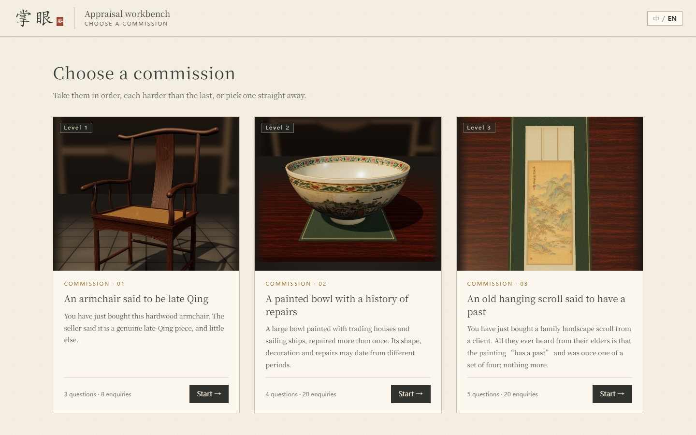
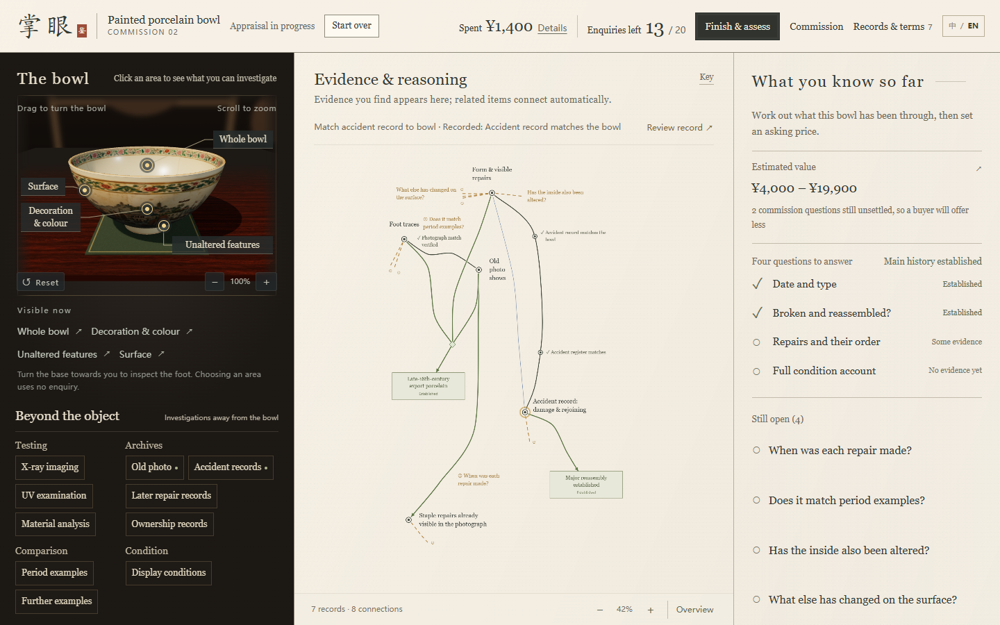

# 掌眼 · Zhangyan

**A long-form antique-appraisal deduction game where understanding unfolds gradually from incomplete evidence.**

### ▶ [Play in your browser](https://nomutsuki.github.io/zhangyan-play/)

Desktop Edge or Chrome. The page is one self-contained file of about 35 MB, so the first load takes a moment. It opens in English; switch to Chinese with **中 / EN**. To play offline, download **Zhangyan.zip** from the [latest release](https://github.com/NomuTsuki/zhangyan-play/releases/latest), extract it and open **Zhangyan.html**.

## The game

Take on three commissions, each harder than the last: a hardwood armchair, a painted porcelain bowl and an old hanging scroll. Examine each object, investigate its records, and follow the connections that emerge between what you know. Decide when you have enough evidence to stop, then set an asking price and sell.

| Commission | Object | Questions to answer | Enquiries | Investigations |
|---|---|---|---|---|
| 01 | Hardwood armchair | 3 | 8 | 10 |
| 02 | Painted porcelain bowl | 4 | 20 | 22 |
| 03 | Hanging scroll | 5 | 20 | 41 |

- **Investigate:** turn the chair or the bowl, or zoom into the scroll laid on the table, to reveal investigation points; or choose archives, comparisons and tests beyond the object. Each investigation uses one enquiry and shows its price first.
- **Follow the evidence:** every finding lands on the map. Select a record, a line or a question to see its basis; look back at any step to replay how it changed the board.
- **Stop and sell:** choose **Finish & assess** when you are ready, with some questions unsettled if you like. Sell to a buyer, who marks down what is unsettled, or pay a listing fee to try the open market. The settlement shows your net result, what the object was worth, and a short review of the round.

How can a game help players hold a long investigation in mind without turning it into a checklist of answers? Zhangyan separates the object's fixed history from the player's gradually revealed knowledge: an observation can be acquired before its relevance becomes clear, and acquiring something and knowing what it supports are separate events. Known records keep their places on the map, and the player alone decides when to stop.

This is a desktop prototype. Its numbers are calibrated by simulation and the author's play, not yet by playtests with strangers. The cases are fictional and are not a professional appraisal reference.

## 中文

**《掌眼》是一款围绕不完整证据展开、通过渐进理解推进的长线古董鉴定推理游戏。**

**[在浏览器里玩](https://nomutsuki.github.io/zhangyan-play/)**：用电脑 Edge 或 Chrome 打开。页面是一个约 35 MB 的独立文件，第一次打开要等一会儿。默认英文，右上角"中 / EN"切换中文。想离线玩，到[最新发布](https://github.com/NomuTsuki/zhangyan-play/releases/latest)下载 **Zhangyan.zip**，解压后打开 **Zhangyan.html**。

三件委托一件比一件难：一把硬木扶手椅、一只彩绘大碗、一幅古画立轴。查看器物、选择调查，在逐渐显露的知识地图上梳理已有信息与关联，再决定何时收手，定价卖出：卖给买家（没查清的事会被压价），或者付上拍费送公开市场。结算页写出净收入、器物实际值多少，以及对这一局的评语。

这是桌面浏览器原型。数值经过模拟和作者试玩校准，还没有经过陌生玩家测试。案例均为虚构，不作为专业鉴定参考。

## Credits · 制作

- **NomuTsuki:** game and systems design, interaction and visual direction, prototype evaluation and final design decisions. Developed as an individually led internship project. 游戏与系统设计、交互与视觉方向、原型评价及最终设计决策，实习期间由作者独立主导。
- **OpenAI Codex, Cursor and Claude Code:** AI assistance with design discussion, implementation, debugging, verification and documentation under the author's direction.
- **Image generation (GPT Image, via Codex):** visual exploration, the bowl's painted texture, the chair's wood and the scroll's painting. Historical images and testing views in the game are synthetic game materials.
- **LXGW WenKai TC** (SIL Open Font License 1.1): the outlines of the characters in the scroll's inscription and seals.

This repository holds only the playable build. The game is developed in a separate, private repository.
